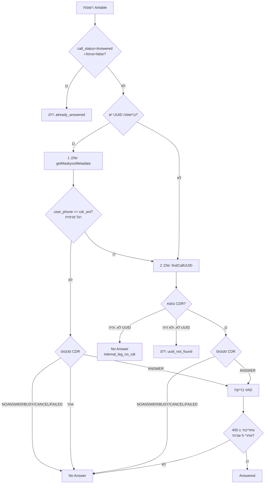

# מתודולוגיה: איתור שיחות שנענו / לא נענו (answer-checker)

> מסמך זה מתאר את השיטה שבה המערכת מסווגת רשומות שיחה ב-Airtable כ-**"Answered"** או **"No Answer"**.
> רכיב: `answer-checker.js` · PORT 3020 · פרוס ב-`/var/webhook-forwarder/` על `root@46.101.212.74` (PM2, fork mode).

---

## תוכן עניינים
1. [העיקרון המרכזי](#1-העיקרון-המרכזי)
2. [מקורות הנתונים](#2-מקורות-הנתונים)
3. [תרשים הזרימה](#3-תרשים-הזרימה)
4. [שלב 1 — UUID קיים ב-Airtable](#4-שלב-1--uuid-קיים-ב-airtable)
5. [שלב 2 — חיפוש לפי טלפון](#5-שלב-2--חיפוש-לפי-טלפון)
6. [טבלת הכרעה לפי סטטוס CDR](#6-טבלת-הכרעה-לפי-סטטוס-cdr)
7. [בדיקת VAD (זיהוי דיבור)](#7-בדיקת-vad-זיהוי-דיבור)
8. [מקרי קצה שמטופלים](#8-מקרי-קצה-שמטופלים)
9. [מגבלות ופשרות מקובלות](#9-מגבלות-ופשרות-מקובלות)
10. [הפעלה](#10-הפעלה)
11. [אימות דיוק (אמת-קרקע)](#11-אימות-דיוק-אמת-קרקע)

---

## 1. העיקרון המרכזי

**רשומה מסווגת "Answered" אם נוצר קשר עם הלקוח אי-פעם** — בכל חייגן, בכל תאריך — ולא רק בניסיון האחרון.

הסיבה: מבחינה עסקית מעניין רק האם הצלחנו ליצור קשר. לקוח שענה פעם אחת לפני חודש נחשב "נענה" גם אם ניסיונות מאוחרים יותר לא נענו.

**אמת-הקרקע היא ה-CDR של Maskyoo** — לא התמלול (`call_transcript`) ולא שדה ה-AI (`No Answer`). שני אלה הוכחו כלא-אמינים (תמלולים משובשים, סיווג AI שגוי).

---

## 2. מקורות הנתונים

| מקור | תפקיד | הערה |
|------|-------|------|
| **Airtable record** | `UUID`, `phone_my_user` (החייגן שלנו), `phone_number` (הלקוח), `call_time`, `call_status` | `call_time` נדרס בכל ניסיון חיוג → לא אמין כתאריך השיחה שנענתה |
| **Maskyoo `cdr_query`** | SQL על `webserviceview` → מחזיר את **רגל הלקוח** | `WHERE cdr_ani=<dialer> AND user_phone=<customer>` |
| **Maskyoo `get_cdr_metadata_by_call_uuid`** | מטא-דאטה ל-UUID → מחזיר תמיד את **הרגל הראשית/פנימית** | מאופיין ב-`user_phone == cdr_ani` |
| **Maskyoo `get_record_by_call_uuid`** | הורדת הקלטת ה-mp3 | מורידים ~400KB (≈25 שניות) בלבד |
| **Silero VAD** (`vad_server.py`) | זיהוי האם יש דיבור אנושי בהקלטה | שרת HTTP מתמיד על `127.0.0.1:9988`, טוען מודל פעם אחת |

---

## 3. תרשים הזרימה



---

## 4. שלב 1 — UUID קיים ב-Airtable

כאשר לרשומה כבר יש `UUID` שמור:

1. **`getMaskyooMetadata(uuid)`** — שליפת מטא-דאטה.
2. **זיהוי רגל פנימית** — אם `user_phone === cdr_ani`, ה-UUID מצביע על רגל הניתוב הפנימית של ה-PBX (IVR/קמפיין/תא קולי), לא על שיחת הלקוח. ההקלטה שלה לא אמינה ל-VAD → **נופלים לשלב 2**.
3. אחרת, מסווגים לפי סטטוס ה-CDR ([טבלה למטה](#6-טבלת-הכרעה-לפי-סטטוס-cdr)).

> פונקציה: `classifyCall(uuid, skipVAD, skipInternalLegCheck)` ב-`answer-checker.js`.

---

## 5. שלב 2 — חיפוש לפי טלפון

מופעל כשאין UUID, או כששלב 1 זיהה רגל פנימית. הליבה היא **`findCallUUID(phoneMyUser, phoneNumber, callDate)`**:

**ניסיון 1 — החייגן שלנו, כל ההיסטוריה:**
```sql
SELECT … FROM webserviceview
WHERE cdr_ani = '<החייגן שלנו>' AND user_phone = '<הלקוח>'
ORDER BY CASE WHEN call_status = 'ANSWER' THEN call_duration ELSE 0 END DESC
```
→ אם קיים **ANSWER** כלשהו מהחייגן שלנו (אי-פעם) — מחזירים אותו מיד. זה מממש את עקרון "נוצר קשר אי-פעם".

**ניסיון 2 — כל חייגן, חלון תאריך:** (רק אם ניסיון 1 לא מצא ANSWER)
```sql
SELECT … FROM webserviceview
WHERE user_phone = '<הלקוח>'
  AND start_call >= '<call_time>' AND start_call < '<call_time + יום>'
ORDER BY CASE WHEN call_status = 'ANSWER' THEN call_duration ELSE 0 END DESC
```
→ תופס **לידים שעברו בין טלפנים** (הלקוח ענה לחייגן אחר באותו יום). **חלון התאריך הצר** מונע זיהום בין קמפיינים — לא ניקח ANSWER ישן מקמפיין אחר.

**אם שני הניסיונות נכשלו:**
- היה UUID (רגל פנימית) אך אין CDR ללקוח → שמרני: **"No Answer"** (`internal_leg_no_cdr`).
- לא היה UUID כלל → **דלג** (`uuid_not_found`), לא דורסים את הסטטוס הקיים.

> ⚠️ למה אין "any-dialer ללא תאריך": גרסה כזו גרמה בעבר ל-false positives נרחבים — היא מצאה כל שיחה ישנה שנענתה לאותו מספר מקמפיין אחר לגמרי. חלון התאריך הוא ההגנה.

---

## 6. טבלת הכרעה לפי סטטוס CDR

`NO_ANSWER_STATUSES = { NOANSWER, BUSY, CALLER CANCEL, NO ANSWER, FAILED }`

| סטטוס CDR | החלטה | שיטה |
|-----------|--------|------|
| NOANSWER / BUSY / CALLER CANCEL / FAILED | **No Answer** | `cdr_status` — ודאי, ללא VAD |
| **ANSWER** | **לא ודאי** → בדיקת VAD | יכול להיות אדם חי או תא קולי |
| סטטוס לא מוכר | No Answer | `cdr_unknown_status` |

> `ANSWER` לבדו לא מספיק! מערכת החיוג מדווחת `ANSWER` גם כשתא קולי "עונה". לכן כל ANSWER עובר VAD.
> חריג: במצב `skipVAD=true` משתמשים בסף משך — `call_duration > 30s` ⇒ Answered (פחות מדויק, לשימוש מהיר בלבד).

---

## 7. בדיקת VAD (זיהוי דיבור)

מטרה: להבחין בין שיחת ANSWER אמיתית לבין צלצול/שקט. מבוצע ע"י **Silero VAD** דרך `vad_server.py`.

**התהליך:**
1. הורדת ~400KB מההקלטה (≈ 25 שניות ראשונות).
2. המרה ל-WAV 16kHz מונו (ffmpeg).
3. זיהוי מקטעי דיבור.
4. **דילוג על 5 השניות הראשונות** (`SKIP_SECONDS=5`) — מסננים צלצול/חיבור.
5. סכימת משך הדיבור שאחרי 5 השניות.

**ההכרעה:**

| תנאי | החלטה |
|------|--------|
| סך דיבור אחרי המבוא **≥ 400ms** (`MIN_SPEECH_MS`) | **Answered** |
| פחות מ-400ms | **No Answer** |

**פרמטרים** (ב-`vad_server.py`): `threshold=0.5`, `min_speech_duration_ms=300`, `min_silence_duration_ms=200`, `SAMPLE_RATE=16000`.

---

## 8. מקרי קצה שמטופלים

| מקרה | הטיפול |
|------|--------|
| **רגל פנימית** (`user_phone==cdr_ani`) | זוהתה בשלב 1 → מעבר לשלב 2 (חיפוש רגל הלקוח האמיתית) |
| **ליד עבר בין טלפנים** | ניסיון 2 ב-`findCallUUID` — כל חייגן בחלון התאריך |
| **שיחה נענתה בעבר, ניסיון אחרון לא** | ניסיון 1 מחזיר את ה-ANSWER הישן (עקרון "נוצר קשר אי-פעם") |
| **זיהום תאריכים** (שיחה ישנה מקמפיין אחר) | חלון תאריך צר בניסיון 2 חוסם זאת |
| **כתיבת UUID ל-Airtable** | רק כש-`cdr_ani == phone_my_user` (מציאה מדויקת, לא fallback) |
| **רשומה כבר Answered** | מדלגים אלא אם `force=true` |

---

## 9. מגבלות ופשרות מקובלות

1. **VAD לא מזהה תא קולי.** ברכת תא קולי היא קול אנושי מוקלט → VAD סופר אותה כדיבור → "Answered". זו מגבלה מהותית של הטכנולוגיה, לא תקלה. **החלטה: בולעים תא-קולי-כ-Answered** ולא מוסיפים heuristics שבירים. (פתרון עתידי אפשרי: תמלול + זיהוי מילות-מפתח של תא קולי בעברית ואנגלית.)
2. **התמלול ושדה ה-AI לא אמינים** — לא משמשים להכרעה, רק ה-CDR.
3. **התוצאות מתיישנות** — לקוח שלא ענה היום עשוי לענות מחר. יש להריץ מחדש מעת לעת, לא פעם אחת.
4. **תלות ב-`call_time`** לניסיון 2 — אם הוא חסר, ניסיון 2 לא רץ (אין חלון תאריך).

---

## 10. הפעלה

**רשומה בודדת:**
```bash
curl -s -X POST http://localhost:3020/check-single \
  -H 'Content-Type: application/json' \
  -d '{"recordId":"recXXXX","airtableConfig":{...},"force":true}'
```

**אצווה (כל הרשומות):**
```bash
curl -s -X POST http://localhost:3020/check-batch \
  -H 'Content-Type: application/json' \
  -d '{"airtableConfig":{...},"limit":0,"force":true}'
```
- `limit:0` = כל הרשומות · `force:true` = סווג מחדש גם רשומות "Answered" קיימות.

**מעקב:**
```bash
curl -s http://localhost:3020/status   # processed / answered / noAnswer / errors / running
```

---

## 11. אימות דיוק (אמת-קרקע)

לבדיקת נכונות סיווג, **שואלים את ה-CDR ישירות** (לא מסתמכים על התמלול):

```sql
SELECT start_call, call_duration, cdr_ani, user_phone, call_status
FROM webserviceview
WHERE user_phone = '<טלפון הלקוח>'
ORDER BY start_call DESC
```

**כלל ההכרעה לאימות:** קיום **ANSWER עם משך ≥ ~15 שניות** = נוצר קשר אמיתי ⇒ הסיווג הנכון הוא "Answered". אם קיימים רק `CALLER CANCEL / BUSY / NOANSWER` (0 שניות) ⇒ "No Answer".

> את `MASKYOO_API_KEY` בשרת אפשר לקרוא מסביבת תהליך ה-PM2:
> `cat /proc/$(pgrep -f answer-checker)/environ | tr '\0' '\n' | grep MASKYOO_API_KEY`

**תוצאת אימות (מדגם 50 רשומות, יוני 2026):** דיוק מלא תחת ההגדרה — 0 false-negative, 0 false-positive (פרט לתא קולי אחד שנבלע ביודעין).

---

*עודכן: יוני 2026*
